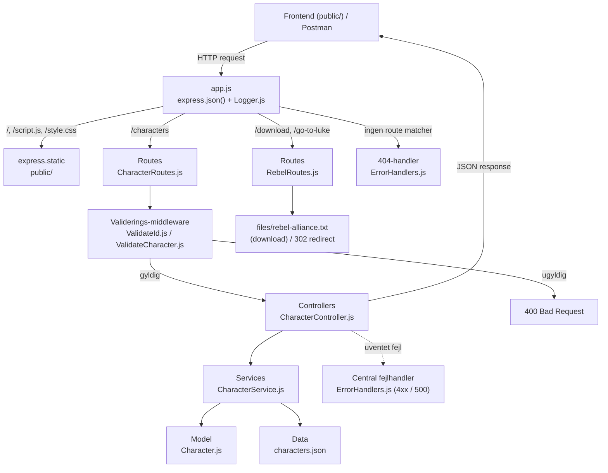
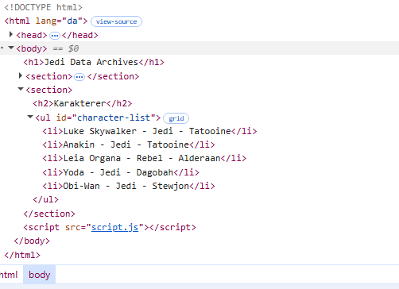
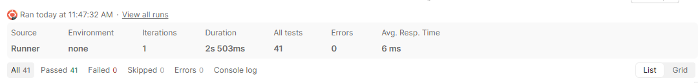

# Star-Wars-Web
Make a Full stack program that communicates via Node.js with CRUD operations. Tested with POSTMAN

## Installation og start
**Krav:** [Node.js](https://nodejs.org/) (version 18 eller nyere) og npm.
```bash
git clone https://github.com/Tobiasrolesen/Star-Wars-Web.git
cd Star-Wars-Web
npm install
npm start
```
Serveren starter på **http://localhost:3000**. Åbn adressen i browseren for at se frontenden.
Porten kan ændres med miljøvariablen `PORT`.
**Nulstil data:** Karaktererne gemmes i `src/data/characters.json`. Tests ændrer filen - nulstil den med:
```bash
git restore src/data/characters.json
```

## API-endpoints
| Metode | Endpoint | Beskrivelse | Statuskoder |
|---|---|---|---|
| GET | `/characters` | Hent alle karakterer | 200 |
| GET | `/characters/:id` | Hent én karakter | 200, 400 (ugyldigt id), 404 |
| POST | `/characters` | Opret en karakter (JSON-body: `name`, `role`, `planet`) | 201, 400 |
| PUT | `/characters/:id` | Erstat en karakter (alle felter kræves) | 200, 400, 404 |
| DELETE | `/characters/:id` | Slet en karakter | 204 (ingen body), 400, 404 |
| GET | `/download` | Download tekstfil om Rebel Alliance | 200 |
| GET | `/go-to-luke` | Redirect til `/characters/1` | 302 |
| GET | `/` | Frontend (`public/index.html`) | 200 |
Ukendte routes giver `404`, og uventede serverfejl giver `500`. Alle fejl returneres som JSON:
```json

{ "error": "Character not found" }
```

## Arkitektur

### Spørgsmål før arkitekturvalg

*Hvor skal HTTP-requests håndteres?*

Routes håndterer, hvor HTTP-requesten skal hen, og så håndterer controlleren, hvad der skal ske med HTTP-requesten. Så det er i controlleren, vi håndterer HTTP direkte.

*Hvor skal karakterdata gemmes?*

Karakterdata skal gemmes i en JSON-fil. Dermed kan vi gemme karakterer imellem hver server-restart. Dette har jeg arbejdet med før, og derfor vil jeg gerne fortsætte med fast gemning i JSON-fil.

*Hvor skal valideringen placeres?*

Valideringen skal ske i vores middleware, før requesten når controlleren. Jeg tjekker først, om data er gyldigt, før jeg sender det ind i vores service. Servicen sørger derefter for, at kun de tilladte felter bliver gemt.

*Hvad er fordelen ved min valgte arkitektur?*

Fordelen ved at jeg har valgt denne arkitektur er, at vores moduler er opdelt efter ansvar, så de er nemme at teste, og at al validering sker ét sted, før data når vores logik.

*Hvilke ulemper har den?*

En ulempe kunne være, at størrelsen på projektet ikke følger med arkitekturen. Men man kan altså ende med at opdele flere ting, hvis projektet skulle blive større.
Det altså en ulempe at når man skal lave noget skal man love noget i mange filer (men det er jo også en fordel)

## Mermaid Diagram



RebelRoutes har ingen controller eller service da den ikke er stor nok til det, hvis opgaven var at større størrelse kunne det godt give mening. Vores controller (hvis vi havde den) ville kun kalde res.download() og ville derfor være en ren boilerplate.

## CharacterService
#### Hvorfor er det en dårlig ide at bruge arrayets længde som ID
Vi har valgt at bruge Math.max med ...ids. Det er gjort da man på den måde oversætter array til noget Math.max forstår
Dermed får vi et nyt unikt id hver gang. Det er en dårlig ide her er et eksempel på hvorfor:
Vi har id 1, 2, 3, 4. Sletter vi id 2, er længden 3. Næste id bliver så 3 + 1 = 4, men id 4 findes allerede, og vi har to karakterer med samme ID.

#### Hvad sker der med karakterrene, når serveren genstartes.
Pt har vi et fast antal af karakter i vores characters.json fil. Disse ville blive. Hvis vi skrev noget nyt ville det også blive
også selvom vi genstartede programmet
Hvis karaktererne kun lå i et array i hukommelsen, ville alle ændringer forsvinde når serveren genstartes,
og serveren ville starte forfra med de karakterer der står i koden. Det er derfor vi gemmer i characters.json.

## US-08: Logging-middleware

* Logger er en middleware funktion der skriver http metoden og urlen for hver request direkte i konsolen
express kører middleware i den rækkefølge de er registreret. Først express.json så logger og til sidst routeren på /charecters
Når loggeren har skrevet sin linje kalder den next, det betyder i teori at den er færdig og er klar til næste led.
Hvis vi udkommentere next ville vi hænge, vi ville stadig logge http requesten men vi vil ikke komme ud at middleware og ud til service og controller.
Man ville altså uden next bare stå og vente på at middleware var done og aldrig vide hvornår. res bliver derfor aldrig sendt og klienten venter forevigt.

## US-09: 404-handler og central fejlhandler

#### Statuskode 400 Bad Request
* Klienten sender noget der er forkert enten ugyldig json eller forkert formart. Serveren kan ikke arbeje på det

#### Statuskode 404 Not Found
* Requestens format er korrekt men det den leder efter findes ikke. Fx id 99

#### Statuskode 500 Server Error
* Serveren fejlede uventet. Hvis fx saveCharacters prøver gemme på en fuld disk. Så får vi 500

#### Hvorfor skal en ukendt ikke give 500?
* Ved forsøg på GET characters/99 og intet blev fundet har serveren gjort præsis det den skulle, den har ledt og svaret ærligt. så derfor er det en 404 og ikke en 500.
hvis vi gav en 500 ville klienten tro at severen var nede og vise "prøv igen senere"

## US-14: Undersøg Network-fanen
Vi åbnede siden på localhost:3000 og trykkede F12 og gik ind under Network. Da vi genindlæste siden kunne vi se
at browseren sender flere requests til serveren. Først index.html, style.css og script.js som kommer fra
express.static og til sidst characters som er vores fetch fra script.js.

#### Hvilken HTTP-metode bliver anvendt?
GET. Når man bruger fetch uden at skrive en metode er det GET som standard.

#### Hvilken statuskode returnerer serveren?
200 OK.

#### Hvad indeholder response-bodyen?
En JSON array med alle karaktererne med id, name, role og planet. I headeren står der Content-Type application/json
så browseren ved at det er JSON.

#### Hvordan bliver JSON omsat til elementer på hjemmesiden?
I script.js laver response.json() teksten om til et javascript array. Derefter går vi igennem arrayet med en
for of løkke og laver et li element for hver karakter med createElement. Teksten sættes med textContent og
til sidst sættes li elementet ind i listen med appendChild. Vi bruger textContent i stedet for innerHTML så
hvis nogen skriver html eller script i et navn bliver det bare vist som tekst og ikke kørt.
Når vi opretter en karakter i formularen kan man se en POST request med statuskode 201. Hvis vi sender noget
ugyldigt får vi 400 og fejlbeskeden fra serveren bliver vist på siden.



## US-15: Download og redirect
* Download og go-to-luke ligger i rebelroutes da det er der de hører til. Der er ingen controller eller service tilknyttet da de ikke indeholder forretningslogik. det ville være spildt kode.

#### Hvad gør res.download?
* Den sender en fil til klienten og sætter header. Headeren fortæller browseren at filen skal gemmes og ikke vises.

#### Hvad gør res.redirect
* Den svarer med statuskode 302 Found og sætter headeren til character/1 uden data. Browseren læser derefter locationen og sender automatisk en GET request på chraracter 1. Derfor ser vi også 2 gange GET i console loggen
fx /go-to-luke
og /characters/1

#### Hvorfor kan vi ikke sende download og redirect på samme request?
* En request kan kun få ét svar. Både res.download og res.redirect sender et helt svar med statuskode og headers.
  Når det første er sendt er svaret afsluttet, og hvis man prøver at sende et mere får man fejlen
  "Cannot set headers after they are sent to the client".

## US-16: Eget kode-review
#### Har funktionerne klare ansvarsområder?
Ja for det meste. Routes bestemmer hvor requesten skal hen, middleware validerer, controlleren håndterer req og res
og vælger statuskode, servicen arbejder med data og modellen bygger karakter objektet. Servicen ved ikke noget om
HTTP og controlleren ved ikke at der findes en fil.

#### Er HTTP-håndtering og forretningslogik blandet sammen?
Nej. Alt med statuskoder og res ligger i controller og middleware. Servicen returnerer bare et objekt, null eller true
og så oversætter controlleren det til 200, 404 osv.

#### Er der gentaget kode?
Ja. res.status(404).json({ error: "Character not found" }) står tre steder i CharacterController (GET, PUT og DELETE).
Det kunne laves som en hjælpefunktion eller servicen kunne kaste en NotFoundError som fejlhandleren laver om til 404.

#### Er valideringen placeret fornuftigt?
Ja. Den ligger som middleware før controlleren så ugyldige data aldrig når servicen eller filen. Hver type input har
sin egen validator, ValidateId til id i URL og ValidateCharacter til body. En svaghed er at ValidateCharacter kun
returnerer den første fejl, og ValidateId godtager "0x10" og "1e2" fordi Number() laver dem om til tal.

#### Er fejlbehandlingen konsekvent?
Alle fejl returneres som JSON med { error: "..." } og det gør det nemt for frontenden at vise dem. Men jeg fandt at
errorHandler altid gav 500, også når fejlen egentlig var en 404, fx hvis download filen manglede.

#### Er koden let at forstå for en ny udvikler?
Jeg synes det er nemt at finde rundt fordi hver fil har et ansvar og navnene passer til mappen. Jeg har også kommentarer
i koden. Ulempen er at man skal kende lagdelingen før man ved hvor man skal kigge.

#### Forbedringer vi fandt
1. errorHandler ignorerer err.status, så en manglende download fil giver 500 i stedet for 404.
2. Arrayet i hukommelsen blev ændret før filen blev gemt. Hvis gemningen fejlede fik klienten 500, men karakteren
   var stadig i hukommelsen og ikke i filen.
3. 404 koden er gentaget tre gange i controlleren.
4. Hvis characters.json er ugyldig starter serveren med en tom liste og næste gang der gemmes bliver den gamle fil
   overskrevet så data er væk.
5. Når man sletter karakteren med det højeste id bliver id'et genbrugt til den næste nye karakter. Det kunne løses
   med en nextId tæller der gemmes i filen.
6. getAllCharacters returnerer selve arrayet så andre dele af koden kan ændre i det. Den burde returnere en kopi.

#### Forbedringer vi har lavet
Forbedring 1: Jeg opdagede den da download filen lå et forkert sted og Jeg fik 500. Fejlen fra Express havde faktisk
status 404. Nu tjekker errorHandler om fejlen har en 4xx status og bruger den. Beskeden vises kun hvis err.expose er
true, fordi beskeden ellers kan indeholde ting som hele filstien på computeren. Jeg testede det ved at omdøbe filen
og nu får vi 404.
Forbedring 2: Jeg fandt den ved at gøre characters.json skrivebeskyttet og oprette en karakter. Jeg fik 500 men
karakteren var stadig med når Jeg lavede GET. Nu bygger servicen en ny liste, gemmer den først og skifter først
characters ud bagefter. Hvis gemningen fejler er den gamle liste uændret. Det gælder både for opret, opdater og slet.
Jeg testede det igen med skrivebeskyttet fil og nu er karakteren ikke med efter en fejl.

## US-17: AI-review
Jeg gav en AI-agent opgavens prompt og lod den gennemgå koden. Den foreslog tre vigtige forbedringer og nogle mindre.
Jeg har selv vurderet forslagene.

#### Accepteret
- errorHandler skal bruge err.status. Det havde Jeg selv fundet og Jeg har lavet det. Men AI'ens kodeforslag sendte
  err.message ved alle 4xx fejl og så ville download fejlen vise hele filstien til klienten. Jeg brugte err.expose i
  stedet.
- Gem til fil før arrayed ændres. Det er lavet (forbedring 2).
- script.js tjekker ikke response.ok når den henter karakterer. Det er rigtigt, men frontenden fanger fejlen med
  catch og viser en besked, så jeg har ikke ændret det.
- getAllCharacters returnerer en reference til arrayet og id genbrug. Det var også på vores egen liste.

#### Afvist
- At serveren skal kaste en fejl og ikke starte hvis characters.json er ugyldig. Det går imod eget krav om at
  serveren ikke må crashe hvis filen mangler eller er ugyldig. Jeg ville hellere lade være med at gemme.
- At /go-to-luke har id 1 hardcodet. Det er et krav i opgaven.
- At lave servicen om til en factory funktion for at gøre den nemmere at teste. Det giver kun mening hvis jeg laver
  automatiske tests og det har vi ikke valgt at gøre.
- At samle alle valideringsfejl og returnere { errors: [...] }. Ideen er god, men frontenden læser data.error så den
  ville gå i stykker. Det ville kræve ændringer flere steder.
  Det jeg lærte er at AI'en fandt mange af de samme ting som mig, men at man ikke bare kan kopiere forslagene. Et af
  dem ville have lavet et sikkerhedshul og et andet gik imod vores egne krav.

## Testing

#### Vi har testet løbende. Under US - 3 testede vi ved at lave CharacterService og kører:
node -e "require('./src/services/CharacterService')"

*Resultatet var ved success:*


*Resultatet ved forkert json:*


*Resultat ved ingen json fil:*


### Vi har efterfølgende testet med Postman

Vi har lavet en Postman Collection der hedder Star Wars API og ligger i repoet som
Star Wars API.postman_collection.json. Den kan importeres i Postman og køres med Run collection.
Den har 24 requests fordelt i mapperne GET, POST, PUT og DELETE. Alle 11 testcases fra opgaven er med, og vi har
tilføjet ekstra som name som tal (123), id i body der skal ignoreres, planet med kun mellemrum, ugyldig JSON,
ugyldigt id (abc) og en ukendt route. Hver request har et test script der tjekker statuskoden og nogle tjekker
også fejlbeskeden.
Vi har testet at ugyldige requests ikke ændrer data ved at sende dem og bagefter tjekke characters.json og
GET /characters. Vi har også testet 500 ved at gøre characters.json skrivebeskyttet.
Før collectionen køres skal data nulstilles med git restore src/data/characters.json, fordi testene opretter,
ændrer og sletter karakterer.

Her er et bevis på at alle test består:



## Refleksion
#### Hvilken arkitektur har vi valgt og hvorfor?
Vi har valgt en lagdelt arkitektur med routes, middleware, controllers, services og en model. Vi valgte den fordi
hvert lag har et ansvar, så det er nemt at finde ud af hvor ny kode skal ligge. Validering ligger som middleware så
ugyldige data aldrig når servicen. Download og redirect har ikke controller og service fordi de ikke har nogen
logik, og så ville det bare være ekstra kode.

#### Hvad ville vi ændre hvis applikationen skulle bruges af mange brugere?
Vi ville skifte JSON filen ud med en rigtig database, fordi filen bliver læst og skrevet i sin helhed og ikke kan
klare at mange skriver på samme tid. Hvis vi skiftede til asynkron fil skrivning skulle vi bruge en queue så to
requests ikke overskriver hinanden. Vi ville også tilføje login, så ikke alle kan slette og ændre karakterer.
Lige nu beskytter valideringen kun data kvaliteten og ikke hvem der har adgang.

#### Hvilke fejl fandt vi under udvikling og test?
- Postman sendte body som Text i stedet for JSON, så req.body var undefined og alt gav "Name must be text".
- I modellen stod der "REBEL" i stedet for "Rebel" og description i stedet for role, så rollen blev ikke gemt.
- Vi havde skrevet require med lille c (characterService) men filen hedder CharacterService. Det virker på Windows
  men ville crashe på Linux.
- IDE'en lavede en auto import så controlleren requirede sig selv.
- Download filen lå i den forkerte mappe og gav 500 i stedet for 404.
- Når gemningen fejlede blev karakteren stadig vist i hukommelsen.
- Postman testene forventede andre fejlbeskeder end dem vores kode sendte.

#### Hvilken forbedring gennemførte vi efter kode-review?
Vi lavede to. errorHandler bruger nu fejlens status ved 4xx fejl, og servicen gemmer til filen før den ændrer
arrayet i hukommelsen. Se US-16.

#### Hvad lærte vi om samspillet mellem frontend og backend?
At frontend og backend kun snakker sammen gennem HTTP og JSON. Frontenden ved ikke noget om vores filer eller
services, den sender bare en request og får en statuskode og JSON tilbage. Derfor er det vigtigt at backend altid
svarer med den rigtige statuskode og samme fejlformat, så frontenden kan vise fejlbeskeden direkte. Vi lærte også
at fetch ikke giver en fejl ved 400 eller 500, så man selv skal tjekke response.ok. Og at validering i browseren
ikke er nok, fordi man altid kan sende requests uden om siden fx med Postman.

## Kvalitetsattributter

Vurdering af løsningen ud fra Sommervilles model for softwarekvalitet (Figure 8.1, *Reliable Programming*).

| Attribut | Spørgsmål | Sådan tager vi højde for det | Begrænsninger | Forbedring | Vurdering (Lav/Middel/Høj) |
|---|---|---|---|---|---|
| **Reliability** | Gør systemet det, det skal, hver gang? | Alle endpoints er testet med 24 Postman requests med test scripts. Validering sikrer at kun gyldige data gemmes, og ugyldige requests ændrer ikke data. | Ingen automatiske tests i koden, testene skal køres manuelt i Postman. Id kan blive genbrugt hvis den nyeste karakter slettes. | Automatiske tests med node:test eller supertest. En nextId tæller i filen. | Middel |
| **Availability** | Er systemet tilgængeligt, når det skal bruges? | Serveren crasher ikke ved fejl. Fejl fanges af errorHandler og serveren kører videre. Manglende eller ugyldig characters.json giver en tom liste i stedet for crash. | Kører kun lokalt på én server. Går den ned er der ingen backup eller genstart. | Hosting med automatisk genstart, fx en process manager eller cloud hosting. | Middel |
| **Resilience** | Kan systemet klare det, når noget går galt? | Servicen gemmer til filen før arrayet ændres, så hukommelse og fil ikke kommer ud af sync hvis gemningen fejler. Uventede fejl giver 500 og serveren kører videre. | Hvis characters.json er ugyldig og der gemmes, bliver den gamle fil overskrevet og data er væk. | Lave en backup af filen eller nægte at gemme hvis indlæsningen fejlede. | Middel |
| **Maintainability** | Er koden let at forstå og ændre? | Lagdelt arkitektur hvor hver fil har ét ansvar. Roller ligger ét sted i modellen. Kommentarer i koden og dokumentation i README. | Mange filer til et lille projekt. 404 koden er gentaget tre steder i controlleren. | Samle 404 håndteringen i fejlhandleren med en NotFoundError. | Høj |
| **Responsiveness** | Svarer systemet hurtigt nok? | Data læses én gang ved opstart og ligger i hukommelsen, så GET requests ikke skal læse filen hver gang. | writeFileSync blokerer serveren mens filen skrives, og hele filen skrives ved hver ændring. Bliver langsomt med mange karakterer. | Database i stedet for JSON fil, eller asynkron skrivning med en queue. | Høj (for projektets størrelse) |
| **Usability** | Er systemet nemt at bruge? | Simpel frontend hvor man kan se og oprette karakterer. Serverens fejlbeskeder vises direkte på siden, og rolle vælges i en dropdown så man ikke kan skrive forkert. | Man kan ikke opdatere eller slette karakterer fra hjemmesiden, kun via API'et. Kun én fejl vises ad gangen. | Knapper til redigering og sletning. Vise alle valideringsfejl på én gang. | Middel |
| **Security** | Er systemet beskyttet mod misbrug? | Alt input valideres på serveren. Klientens id og ekstra felter ignoreres. Frontenden bruger textContent så man ikke kan indsætte scripts (XSS). Fejlbeskeder viser ikke interne detaljer som filstier. | Ingen login, så alle kan oprette, ændre og slette karakterer. Ingen begrænsning på hvor mange requests man kan sende. | Login og roller (fx kun admin kan slette) og rate limiting. | Lav |
