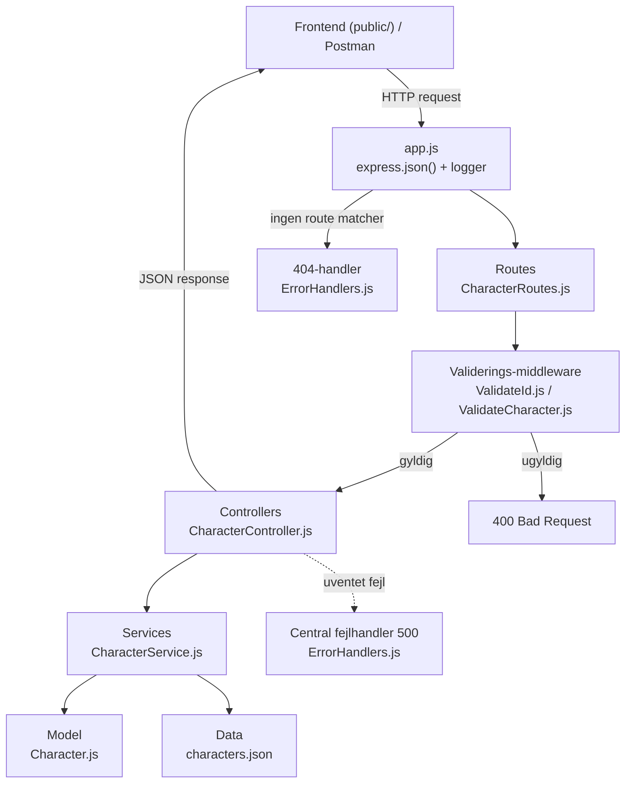
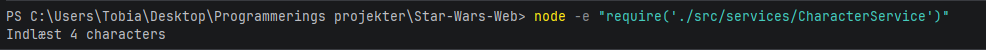
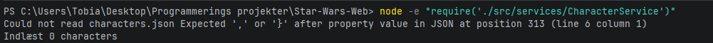
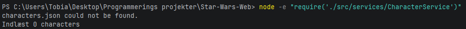

# Star-Wars-Web
Make a Full stack program that communicates via Node.js with CRUD operations. Tested with POSTMAN

## Arkitektur

### Spørgsmål før arkitekturvalg

*Hvor skal HTTP-requests håndteres?*

Routes håndterer, hvor HTTP-requesten skal hen, og så håndterer controlleren, hvad der skal ske med HTTP-requesten. Så det er i controlleren, vi håndterer HTTP direkte.

*Hvor skal karakterdata gemmes?*

Karakterdata skal gemmes i en JSON-fil. Dermed kan vi gemme karakterer imellem hver server-restart. Dette har jeg arbejdet med før, og derfor vil jeg gerne fortsætte med fast gemning i JSON-fil.

*Hvor skal valideringen placeres?*

Valideringen skal ske i vores middleware, før requesten når controlleren. Jeg tjekker først, om data er gyldigt, før jeg sender det ind i vores service. Servicen sørger derefter for, at kun de tilladte felter bliver gemt.

*Hvad er fordelen ved min valgte arkitektur?*

Fordelen ved at jeg har valgt denne arkitektur er, at vores moduler er opdelt efter ansvar, så de er nemme at teste, og at al validering sker ét sted, før data når vores logik.

*Hvilke ulemper har den?*

En ulempe kunne være, at størrelsen på projektet ikke følger med arkitekturen. Men man kan altså ende med at opdele flere ting, hvis projektet skulle blive større.

## Mermaid Diagram

## CharacterService
#### Hvorfor er det en dårlig ide at bruge arrayets længde som ID
Vi har valgt at bruge Math.max med ...ids. Det er gjort da man på den måde oversætter array til noget Math.max forstår
Dermed får vi et nyt unikt id hver gang. Det er en dårlig ide her er et eksempel på hvorfor:
Vi har id 1, 2, 3, 4. Sletter vi id 2, er længden 3. Næste id bliver så 3 + 1 = 4, men id 4 findes allerede, og vi har to karakterer med samme ID.

#### Hvad sker der med karakterrene, når serveren genstartes.
Pt har vi et fast antal af karakter i vores characters.json fil. Disse ville blive. Hvis vi skrev noget nyt ville det også blive
også selvom vi genstartede programmet

## US-08: Logging-middleware

Logger er en middleware funktion der skriver http metoden og urlen for hver request direkte i konsolen
express kører middleware i den rækkefølge de er registreret. Først express.json så logger og til sidst routeren på /charecters
Når loggeren har skrevet sin linje kalder den next, det betyder i teori at den er færdig og er klar til næste led.
Hvis vi udkommentere next ville vi hænge, vi ville stadig logge http requesten men vi vil ikke komme ud at middleware og ud til service og controller.
Man ville altså uden next bare stå og vente på at middleware var done og aldrig vide hvornår. res bliver derfor aldrig sendt og klienten venter forevigt.

## Testing

#### Vi har testet løbende. Under US - 3 testede vi ved at lave CharacterService og kører:
node -e "require('./src/services/CharacterService')"

*Resultatet var ved success:*

*Resultatet ved forkert json:*

*Resultat ved ingen json fil:*

### Vi har efterfølgende testet postman

#### Se linket

(indsæt link)

## Kvalitetsattributter

Vurdering af løsningen ud fra Sommervilles model for softwarekvalitet (Figure 8.1, *Reliable Programming*).

| Attribut | Spørgsmål | Sådan tager vi højde for det | Begrænsninger | Forbedring | Vurdering (Lav/Middel/Høj) |
|---|---|---|---|---|---|
| **Reliability** | Gør systemet det, det skal, hver gang? | | | | |
| **Availability** | Er systemet tilgængeligt, når det skal bruges? | | | | |
| **Resilience** | Kan systemet klare det, når noget går galt? | | | | |
| **Maintainability** | Er koden let at forstå og ændre? | | | | |
| **Responsiveness** | Svarer systemet hurtigt nok? | | | | |
| **Usability** | Er systemet nemt at bruge? | | | | |
| **Security** | Er systemet beskyttet mod misbrug? | | | | |			
